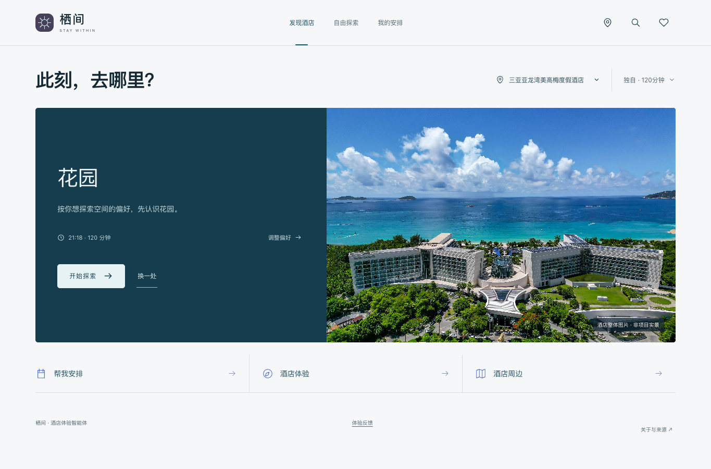

<!-- 当前可审阅草稿，未发布。署名按用户要求留到最终提交时确认。项目仓库和公开视频需发布后替换本地相对链接。 -->

## 参赛项目名称

栖间：把一次入住，变成自己的旅程

参赛方向：高品质酒店 staycation。

## 团队 / 作者与奖品领取人

- 团队名称：【最终提交时确认】
- 主要提交人 GitHub ID（仅1位）：【最终提交时确认】
- 其他成员：【最终提交时确认】

## 旅行场景与目标用户

高品质酒店及度假酒店的住客，尤其是亲子、双人和独自入住者。酒店里的设施、餐饮、空间与活动信息往往分散，住客不清楚有哪些值得体验、如何参与、怎样放进自己的空闲时间。

栖间从“打开就发现一个体验”开始，让客人先看到内容，再选择浏览、收藏或安排，减少必须先想好问题才能使用AI的门槛。

## 我做了什么

开发了可操作的酒店体验智能体：

1. 按城市和酒店名称真实搜索，以平台身份区分酒店与分店。
2. 新酒店打开后取得飞猪体验原文，由百炼摘录；程序检查名称和证据，绑定来源与查询日期。
3. 按同行人、兴趣、时间及已知条件主动推荐，支持分类、搜索、详情和收藏。
4. 生成时间安排；支持保留时段、单项替换/移除、参与准备、保存恢复与导出。
5. 酒店周边独立查询，外出时间由客人预留；各酒店资料与入住状态隔离。

七尚与安达仕为官网核对过的深度样例；其他酒店复用同一处理链路。特色在于“来源绑定的体验资料＋主动入口＋可持续编辑的入住状态＋确定性约束”，同时提供手机操作界面。缺少资料时保留未知或降级，不用样板酒店填充其他酒店。

## 百炼使用说明（必填）

- 百炼能力 / 模型：运行时调用通义千问，默认配置 `qwen-plus`；实际演示模型以随附运行记录为准。
- 调用方式：服务端百炼 OpenAI 兼容 HTTP API；飞猪通过官方 FlyAI CLI 调用真实查询。
- 使用环节与输入输出：
  - 体验摘录：输入当前酒店身份与编号原文片段，输出项目名称、类别、范围和片段编号；程序校验并还原证据。
  - 主动发现：输入同行人、偏好、时间与合法候选，输出候选选择及简短解释；程序限制为当前酒店候选。
  - 时间安排：输入来源事实、时间预算和已保留事项，输出安排建议；程序检查时段、固定事项、未知费用及范围约束。
- Skill 名称：FlyAI 官方能力通过 CLI 使用；前端开发使用 Impeccable 设计技能指导，后者不参与酒店事实生成。
- 其他工具 / 技术栈：Node.js 24、原生 JavaScript/CSS、SQLite、SSE。应用没有 npm 运行依赖；服务端保存凭据，前端不接收密钥。

## 效果展示

实际操作演示：[原速录屏 MP4](https://github.com/caiyize123-wq/qijian-stay-agent/releases/download/v0.1.0/real-walkthrough.mp4)。截图见 [media](media/)；演示按真实界面操作，不伪造接口结果。新酒店首次整理、百炼规划、单项修改和刷新恢复的记录见 [evidence](evidence/)。

官网资料核对范围为两家样例的14项体验，其中13项可对照官网，1项在店课程仍待取得当前排期与现行套餐说明；补入此前漏掉的七尚 OLI-FISH 和安达仕水疗，并修正七尚合并水疗入口的时段。核对不等于酒店工作人员或现场确认。

自动化与真实外部API调用分开记录；模拟图片或模型故障明确标识。尚未收齐真实住客试用反馈，不填写满意度、节约时间或用户增长数字。

## 项目链接与复现方式

- 项目仓库：https://github.com/caiyize123-wq/qijian-stay-agent
- 下载包及演示：https://github.com/caiyize123-wq/qijian-stay-agent/releases/tag/v0.1.0
- 当前不提供托管在线服务，评委可下载后使用自己的凭据复现。
- 本地复现：见 [REPRODUCE.md](REPRODUCE.md)。解压后配置自己的百炼和飞猪凭据，运行 `npm run check`、`npm test`、`npm start`。
- 真人试用：运行后打开 `/tryout.html`，完成三个任务并主动导出真实反馈。
- 图片与第三方说明：见 [THIRD_PARTY_NOTICES.md](THIRD_PARTY_NOTICES.md)。

本项目是独立参赛作品，不是酒店官方服务。平台资料不能保证覆盖所有酒店项目或反映当天状态；安排不是预约。地图只是空间示意；新酒店缺少真实内部路网时不提供导航。当前主要验证单次时间窗口，尚未完成多日跨夜入住与酒店库存系统接入。

## 踩坑记录

- 飞猪酒店列表与语义搜索文本格式不同，不能把文本误解析成空列表。
- 一类设施可能有多个项目，不能只保留每种类别的一项。
- 酒店、所属度假区和周边景点容易混淆，分开处理，度假区项目需主动选择。
- 模型与查询可能超时；保留原文与缓存、合并在途任务，并提供可见重试。
- 无图项目使用类别图形；未知开放、费用、权益、排期和路线不推测。

> 奖品说明：每个团队最多发放1份奖品，仅登记1位主要提交人和奖品领取人。
